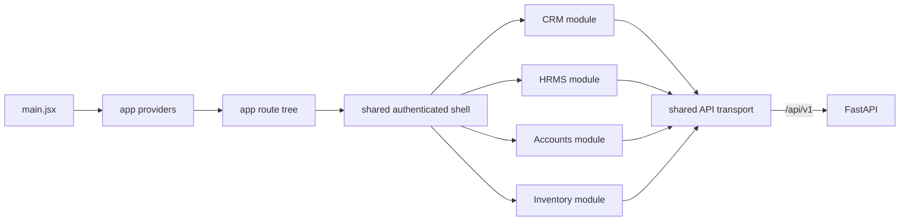
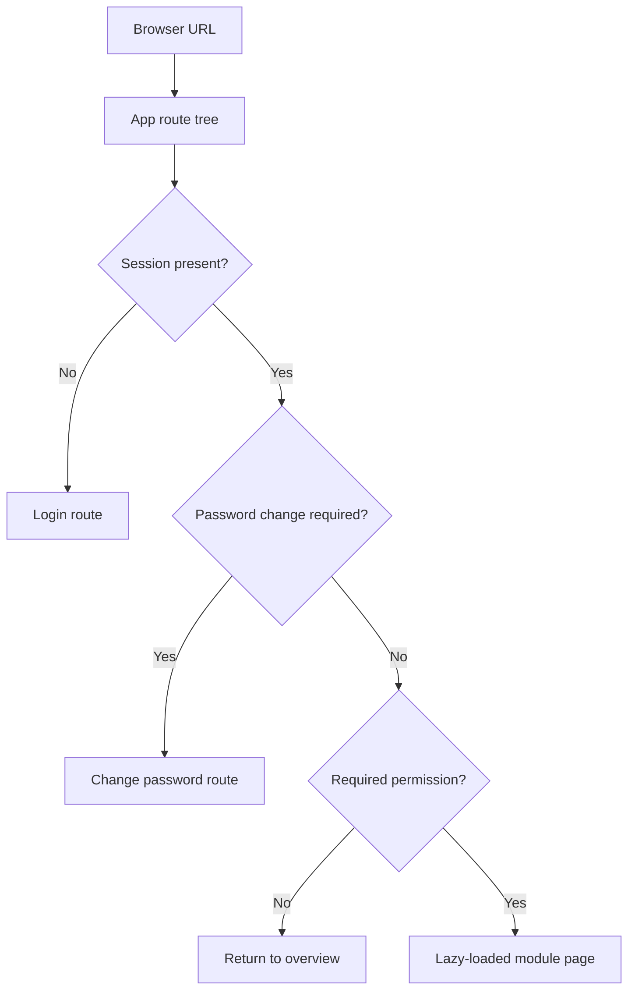

# ERP Frontend Architecture

## Purpose

The frontend is a React application for the ERP API. It is organized as a modular client: platform-wide behavior lives in `shared`, route composition lives in `app`, and each business area owns its screens and API operations in `modules/<name>`. The frontend follows the backend's module boundaries and OpenAPI contract.

The attached platform architecture document is the product reference. This file describes the frontend structure and how future modules join it without turning the app shell into a collection of module-specific logic.

## Frontend shape



Modules are lazy-loaded at their route boundary. Keep the platform shell small and stable while business pages evolve independently.

## Folder structure

```text
src/
  main.jsx                          # React root, browser router, global styles
  app/
    App.jsx                         # route tree and access guards
    AppProviders.jsx                # global providers only
  shared/
    api/
      client.js                     # credentials, CSRF header, error normalization
    auth/
      AuthProvider.jsx              # login, session restore, logout, permissions
      api.js                        # shared session endpoint functions
      PermissionRoute.jsx           # route-level convenience guard
    organization/
      api.js                        # shared department data used across modules
    layout/
      AuthenticatedLayout.jsx       # shared navigation and shell
    hooks/                          # small cross-module hooks
    ui/                             # reusable visual primitives
  modules/
    auth/                            # login and password lifecycle pages
    dashboard/                       # workspace overview
    crm/
      api.js                         # CRM endpoint functions
      routes.jsx                     # lazy route declarations
      pages/
      components/
      hooks/
      schemas/
    hrms/                            # same shape when implemented
    accounts/
    inventory/
```

Do not add empty folders for every possible future module. Create a module when its first workflow is ready to implement.

## Ownership rules

- `app` owns top-level route composition, global providers, and application startup. It does not own business pages or endpoint details.
- `shared/api` owns HTTP mechanics only: base URL, cookies, CSRF, JSON parsing, and normalized errors. It does not know about users, quotes, or invoices.
- `shared/auth` owns session state, session endpoint functions, and permission helpers. It does not define each module's permission policy; module navigation and backend endpoints use the permission codes declared by the backend.
- `shared/organization` owns company department data because user assignment and multiple business modules consume it.
- `shared/layout` owns global navigation, responsive shell, and common feedback placement. It reads menu entries and permissions without implementing module workflows.
- Each `modules/<name>` folder owns its page composition, endpoint wrappers, domain-specific forms, validation, and view types. Modules should not import another module's components or local state.
- Reusable UI belongs in `shared/ui` only after it is needed by more than one module. Keep module-specific components local.

## Route and permission flow

`app/App.jsx` is the explicit route assembly point. Each module exports its own route declarations from `modules/<name>/routes.jsx`. Routes are lazy-loaded. Navigation entries carry a permission code and are hidden when the signed-in user lacks that code.



These guards improve navigation only. The backend remains responsible for authentication, authorization, row scope, and field access on every request.

## API boundary and data flow

```text
module page -> module api function -> shared request client -> /api/v1 -> FastAPI router
```

- A page calls a function from its module's `api.js`; it does not construct endpoint URLs or call `fetch` directly.
- The module API file uses the shared request client and returns typed domain data.
- `shared/api/client.js` always sends `credentials: "include"`, adds `X-CSRF-Token` for writes, and converts API errors into one frontend error type.
- Session data comes from `/auth/login` and `/auth/me`; never store the session cookie in JavaScript or local storage.
- Use the backend's `/openapi.json` as the API contract. Generate TypeScript types/client from the versioned OpenAPI document before the first complex CRM workflow; do not hand-maintain a second set of endpoint types.
- Keep the dev proxy and production reverse proxy aligned so `/api/v1` is same-origin where possible. For direct cross-origin calls, configure credentialed CORS and cookie settings together.

## State and forms

- Session and permission state are global because all modules depend on them.
- Server records are module-owned. Before CRM workflows add caching, filtering, pagination, and optimistic updates, standardize on TanStack Query so modules do not build separate cache and loading behavior.
- Form state stays local to a page or feature. Adopt React Hook Form and Zod when the first multi-step or heavily validated business form is introduced; use backend validation errors as the final authority.
- Do not copy backend data into global context unless it is truly application-wide.

## Adding a module

1. Confirm the backend permission codes and API response/request schemas for the workflow.
2. Create `src/modules/<name>/api.js` for endpoint calls and `routes.jsx` for lazy route declarations.
3. Add module pages, local components, and schemas under that module; use shared UI only for cross-module needs.
4. Register the module route in `app/App.jsx` and permission-aware navigation in `shared/layout/AuthenticatedLayout.jsx`.
5. Keep backend and frontend API changes in the same work item. Review the OpenAPI diff and make sure the module cannot call another module's private endpoint wrapper.
6. Add page, permission, and workflow tests when the module has real workflows. Keep fixtures and API mocks inside the module test area.

## Current implementation notes

- Login, session restore, logout, required password change, user administration, and departments are connected to the existing backend.
- `modules/users` keeps user administration endpoints in its local `api.js`; shared auth and department data use shared APIs because multiple areas depend on them. New business modules should keep their endpoint operations in module-local `api.js` files instead of calling the shared transport directly.
- The initial frontend is JavaScript/JSX. Before the CRM surface grows, migrate module contracts to TypeScript using generated OpenAPI types. Avoid a whole-app rewrite; migrate one module at a time.
- The frontend currently uses a small `useResource` hook for straightforward lists. Replace it with the agreed server-state library before complex CRM data flows are added.
